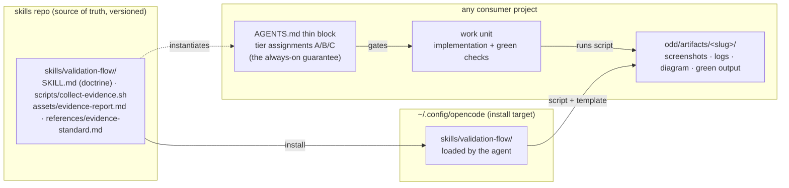
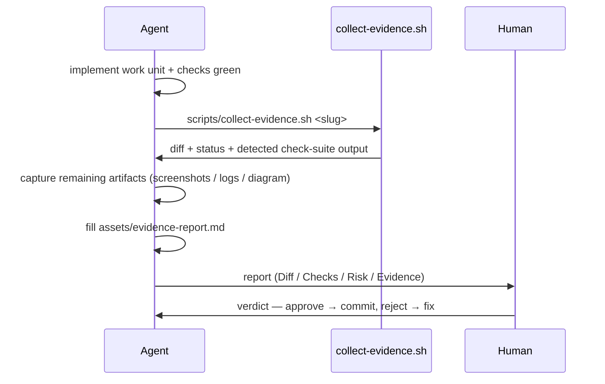

# F1 — Architecture: the validation-flow kit

One job per piece. No guarantee rests on skill trigger matching.

## Delivery ritual (deterministic, in-skill)

Key properties:

- **AGENTS.md block** = the guarantee (in context every session, no invocation needed).
- **The kit** = the ritual: generic script collects, template orders, references specify quality bars — the report is always delivered in the same logical order.
- **Skill trigger matching** = bonus depth only.
- Independence: no repository, framework or absolute home path anywhere in the kit — verified by grep over the whole directory (`checks.log`, T3).
